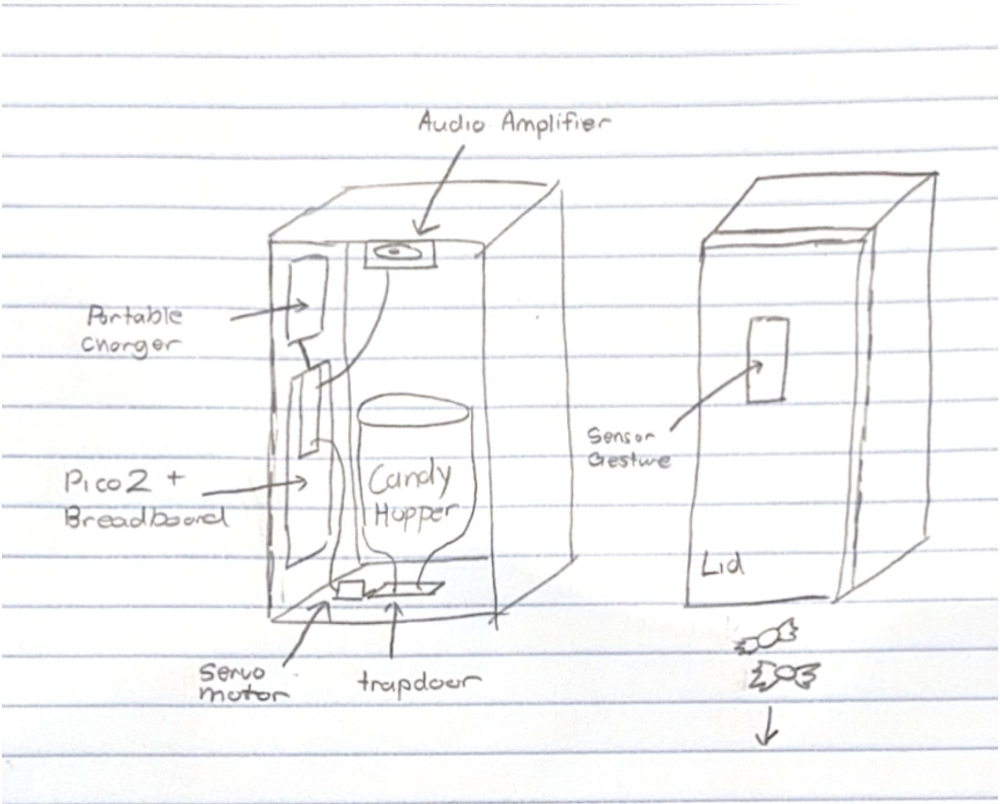

# DSGN 297 Project - Gesture Controlled Candy Dispenser

## Parts
1. [Adafruit APDS9960 Proximity, Light, RGB, and Gesture Sensor - STEMMA QT / Qwiic](https://www.adafruit.com/product/3595?srsltid=AU7gw4VToeeUxaLtNZG3SObgkkULDQJS7FY_sgGjZMRgCKLbCGkWX1So)
2. [Adafruit Servo Motor](https://www.adafruit.com/product/169?gad_source=1&gad_campaignid=23986111167&gbraid=0AAAAADx9JvSJUZUSseJb2ZHKM92jXEQAs&gclid=CjwKCAjwlY3WBhANEiwApsNrLWcaSX9sgr-RxByvzS_1sxhQ0rKlgF0yL_DZ-E_RAd7hC72mF15cbBoCdAkQAvD_BwE)
3. [Adafruit Mono 2.5W Class D Audio Amplifier - PAM8302](https://www.adafruit.com/product/2130?srsltid=AU7gw4WwSCUwquGYdkQXEV36IvX8Iuxc8dNPGCAXkWGRGk6sJRRov35k)

## Sketch

## Build Process

TODO
